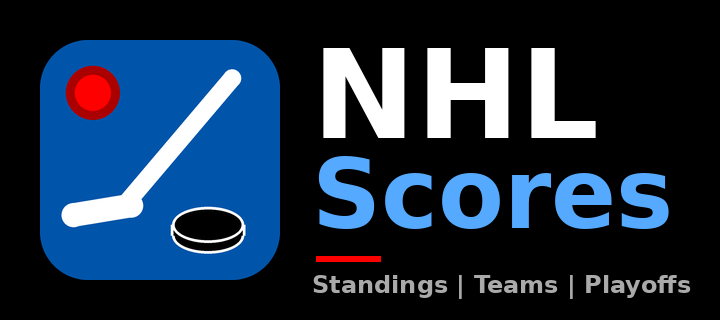
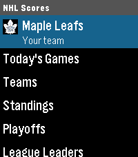
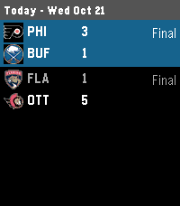
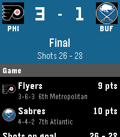
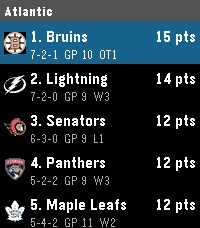
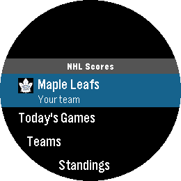
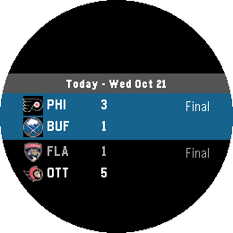
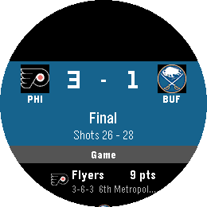

<p align="center"></p>

# NHL Scores 🏒

The whole NHL on your Pebble. Follow your team, browse every game, and check the standings, using the buttons or the touchscreen.

<p>




</p>
<p>



</p>

## Features

- **My Team**: your team's live score right on the home screen, plus its record, division rank, last 10, next games and recent results
- **Today's Games**: every game with team logos, scores and period or clock. Open one for the full game screen.
- **Game screen**: big scoreboard, power plays, shots, goals by period with assists, goalies and playoff series status. It refreshes every 15 seconds while the game is live.
- **Teams**: all 32 teams grouped by division, each with its own page
- **Standings**: by division, East and West wild card, conference or whole league, with W-L-OTL records, points and streaks
- **Playoffs**: series scores for every round
- **League Leaders**: points, goals, assists, plus/minus, goalie wins, save % and goals against average

## Goal alerts

While the app is open, you get a vibration and an animated goal light when your team, or any team you follow, scores. The app can also open your team's live game when you launch it, and wake itself at puck drop.

## Controls

| Action       | Buttons     | Touch       |
|--------------|-------------|-------------|
| Scroll       | Up / Down   | Swipe       |
| Open         | Select      | Tap         |
| Back         | Back        | Swipe right |
| Make it my team | Hold Select on a team | |

## Settings

Open the app's settings in the Pebble phone app to pick your team, choose extra teams to follow, and turn vibration, auto-open and puck-drop wake-up on or off.

## Platforms

Emery (Pebble Time 2) and Gabbro (Pebble Round 2).

## Build

Needs Pebble SDK 4.33 or newer.

```
./scripts/run_emulator.sh emery    # or gabbro
```

That builds the app, installs it in the emulator and opens it. (`pebble install --emulator` on its own installs the app but doesn't open it.)

Or [open it in CloudPebble](https://cloudpebble.repebble.com/ide/import/github/brooks2564/NHL-Live-Scores-APP).

Scores come from the NHL's free public API, so there's no account or key to set up.

## Author

Brooman Inks
